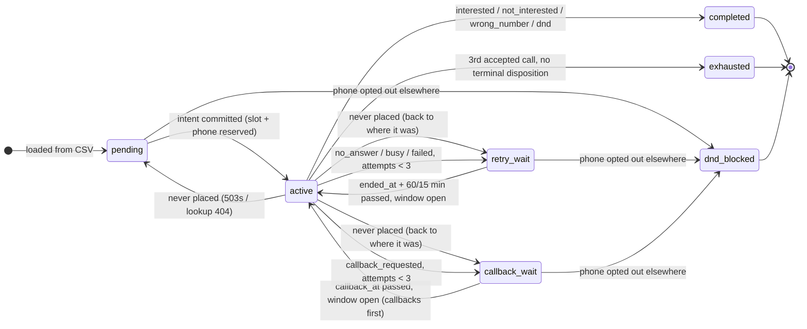
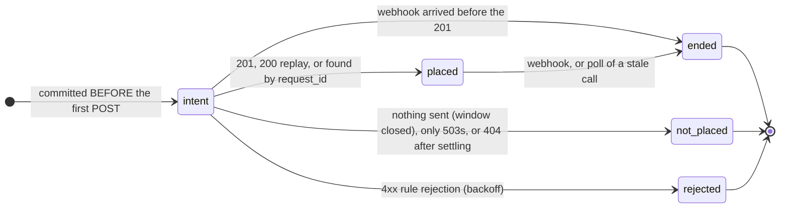

# Submission

## Candidate
- **Name:** Nadeem Shabir Mir
- **Assignment chosen:** B (Workflow): Durable Campaign Dispatcher
- **Time spent :** 7-8 hours, majority times goes in code reviweing

## How to run
```bash
# setup (Linux / macOS / WSL, Python 3.11+)
python3 -m venv .venv && source .venv/bin/activate
pip install -r requirements.txt

# terminal 1: the provider
cd assignment-b-workflow && python -m mock_telephony

# terminal 2, repo root: the dispatcher (runs until every lead is final, writes ./final_state.csv)
source .venv/bin/activate
python -m solution.dispatcher
# after a kill -9: run the SAME command; it resumes from dispatcher.db
# (or starts fresh by itself if the provider was restarted)

# check it like the graders: /admin/report violations + diff against /admin/leads
python -m solution.tools.verify

# tests (~120, a few seconds, fake clock, no network)
pytest
```
More detail, the kill -9 drill and a code map: [`solution/README.md`](solution/README.md).

## Design

**Shape.** One Python process, one asyncio event loop, one SQLite database (WAL mode)
that is the *only* source of truth. Four loops share it:

```
 provider :8099 ──webhooks──► webhook server (FastAPI/uvicorn, same loop) ─┐
       ▲                                                                   │ apply_result
       │ POST /v1/calls            scheduler ── reserve_dials ─────────────┤
       └──────────────────── dialer tasks ◄────┘                           ├──► SQLite
       ▲ GET /v1/calls?request_id=, /v1/calls/{sid}                        │
       └──────────────────── reconciler (unknown outcomes, lost webhooks) ─┘
                             clock loop (re-read /v1/clock to detect a provider restart)
```

Every store method that changes state is **one synchronous transaction**, no store method
contains an `await`, and all handlers run on the event-loop thread, so no two pieces of this
process can interleave inside a decision. Process memory holds nothing that matters: after
`kill -9` the database alone says what to do next.

**Two small state machines.** A *lead* (what we owe the customer) and a *call attempt*
(what we know about one `request_id`, however many POSTs it takes). A lead is `active`
exactly when it has one open call.



Not drawn: a few defensive transitions that should never fire. For example, if the provider
rejects a dial as `dial_after_terminal`, `max_attempts_exceeded` or `dnd_violation`, the lead
is finished (`completed`, `exhausted` or `dnd_blocked`) instead of being dialled again.



**How dialling stays at-most-once and inside every rule.** The dangerous gap is between
"decided to dial" and "provider accepted". The protocol:

1. **Reserve.** In one transaction: re-check every rule against the DB, insert a `calls`
   row (`phase='intent'`, fresh `request_id`), mark the lead `active`, commit. From this
   instant the call counts against its tenant's limit (R2) and locks its phone (R3),
   whether or not it ever reaches the provider. R3 is also enforced by the database
   itself: a partial unique index allows one open call per phone.
2. **POST, re-sending the same `request_id` until the answer is definitive.** 201/200 → placed.
   503 → nothing placed, re-send. 504 or no answer within 0.5 s → *maybe* placed, re-send:
   the provider performs at most one call per `request_id`, so the re-send either places it
   now (201) or returns the one that exists (200). It can never create a second call.
   The window is re-checked before every send.
3. **Unresolved → look it up.** If the tries run out or the window closes and some POST
   might have placed the call, the intent keeps its slot and phone and the reconciler asks
   `GET /v1/calls?request_id=`. Found → placed. 404 while the window is still open →
   hand it back to step 2 (same key, so still at most one call). 404 after the window has
   closed → never placed, trusted once no POST of ours can still be on its way (3 s).

A crash mid-POST ends up in the same step 3 as a 504 or a lost 201 that step 2 could not
settle. That's why recovery after `kill -9` needs almost no special code: one step at
startup restarts the 3 s settle timer of the open intents (`Store.after_restart`), and then
the reconciler resolves them like any other unresolved call. The scheduler can start
immediately, because unresolved calls keep holding their resources until they are settled.

**Results of a call** come from the webhook (HMAC-verified on the raw bytes) *or* from
asking the provider: a poll of a call that ended without one, a lookup by `request_id`, or
the 200 replay to a re-sent POST. All of them call the same idempotent `Store.apply_result`.
A duplicate finds the call already `ended` and changes nothing.

**Why not Temporal.** Durability is the thing being assessed, and with a DB-backed state
machine I can point at the exact line that makes each step safe. Temporal would give
durable timers, retries and workflow history for free, plus horizontal scale. The cost is
a server dependency and a programming model whose guarantees I'd be taking on trust inside
a 6–8 h box. At 200 leads, one process plus SQLite is the simplest design I can fully
explain.

## Decisions & assumptions

| Decision | Why | Alternative considered |
|---|---|---|
| SQLite state machine, one process | Durability I can explain line by line; zero infra for graders; one scheduler makes R2/R3 trivial to reason about | Temporal (see above); Postgres + several workers (needs leases) |
| Commit the intent **before** the POST | The only way a crash between "decide" and "dial" can't double-dial or lose a lead | POST then record (a crash in between loses or repeats a call) |
| One `request_id` per intent, re-sent on 503/504/timeout | Provider guarantees at-most-once per key. A 503 is re-sent after 50 ms; a 504 holds the slot for one 0.5 s timeout (5–10 sim-min), not the 2 s (20–40 sim-min) it takes to arrive | New key after 503 + lookup after each 504 (the first version: correct, but a 504 near window close pushed callbacks to the next day) |
| Unresolved calls keep holding slot + phone | Ambiguity costs throughput, never a violation | Optimistic release (risks 409/429) |
| Counts derived from DB rows (open calls, accepted calls) | Survives restarts by construction, can't drift | In-memory counters/semaphores (lost on kill -9) |
| Start ≥ 5 s after any boundary. Never start within 2 min of a window's end (fresh, retry) or 30 s (due callback) | Under load, the time from our window check to the provider accepting the call was usually under ~130 sim-s; every 201 is checked for this. A fresh or retry call loses nothing by waiting for the next window. A due callback was promised for now, so it gets 30 s; with the provider's 120 s grace that still covers ~150 sim-s | One 2-min margin: callbacks asked for 20:28/20:29 went out the next morning, ~870 min late. One 30-s margin: too thin for calls that can wait |
| Sim time = the provider's own formula, `sim_epoch + (time.time() − real_epoch) × speed`, computed locally | It shares our host clock (it calls us on localhost), so this is *exactly* the provider's time. Nothing is estimated, so an event-loop stall can't shift it, and a host clock step moves both of us together. Every 201's `created_at` is still checked against our send time | Anchor to one round trip + `time.monotonic()`. The first version: a 2 s stall put us 19 sim-min behind → 2 violations in a loaded chaos run. Also removed later: an offset correction for a provider on another machine; it never fired in any run |
| SQLite WAL, `synchronous=NORMAL`, auto-checkpoint off: no fsync on the event loop during a run | Survives `kill -9`. Measured: FULL blocks the loop 2–25 ms per commit; auto-checkpoints still stall up to 12 ms on an idle disk. Every ms of stall is 0.6–1.2 sim-s added to the time between our window check and the provider accepting | FULL (only adds power-loss durability; a power loss also wipes the provider's in-memory state) |
| Lookup 404 inside the window → re-send the same key; after the window → release after a 3 s settle | Re-sending is safe without knowing; releasing isn't, since a 404 can't prove "never placed" while a POST of ours may still be in flight | Always wait for the settle. The first version: after a `kill -9` it held a callback's slot ~60 sim-min, past the window close → 891 min late |
| Poll `placed` calls older than 8 sim-min | Longest simulated call is ~6.5 sim-min, so the webhook is lost or we were down | Poll everything (wasteful); wait for redelivery (provider gives up after 3) |
| Priority: due callbacks (oldest first) > due retries (oldest first) > fresh, a busy phone is skipped, not blocking | R6, without head-of-line blocking | Strict FIFO |
| Fresh leads interleaved across a tenant's campaigns by CSV position | Fair; neither campaign starves the other | Campaign by campaign |
| Phones compared as exact strings, not normalised | The provider identifies a lead by the exact uploaded string; the fixture data is clean E.164 (checked) | Normalise (would diverge from `/admin/leads` if formats differed) |
| `customer_name` is never stored | PII we don't need | Store everything |
| Unknown disposition, or `callback_requested` without `callback_at` → retry after the longest wait | Conservative; an unknown disposition is logged as a warning | Treat as terminal |
| A 4xx rule rejection → release the intent at once and back off 10 sim-min; `dnd_violation` → block phone; `dial_after_terminal`/`max_attempts_exceeded` → finish the lead. The same after an ambiguous POST: a released intent can never be re-sent | Should never happen; if it does, don't turn one violation into many. The provider answers 200 for a key that already has a call, so a 4xx means this key has none | Retry immediately; resume like any unresolved intent (found in review: that would re-send and collect a violation per round) |
| One command for first start *and* every restart; no `--reset` flag | Resume if the DB belongs to the running provider (identified by its epoch); start fresh by itself if not. A grader re-running the first command after `kill -9` can't wipe live state | A `--reset` flag (found in review: re-using it on restart would forget live calls → double dials) |

## Failure modes considered

| What goes wrong | What happens |
|---|---|
| `kill -9` anywhere | Each transition is one transaction; on restart unresolved intents are looked up, stale placed calls are polled, scheduling resumes immediately (reservations persist) |
| Crash after commit, before/while POSTing | Intent orphaned → lookup by `request_id` → placed, or re-sent with the same key (window open), or released (window closed) |
| 503 | Re-send same key; never counted as an attempt (R4) |
| 504 (call placed, response lost) | Re-send same key → 200 replay with the `call_sid`, counted once |
| 504 (call not placed) | Re-send same key → placed now, or eventually released via lookup |
| Our own client timeout | Same as 504 |
| Webhook duplicated | `apply_result` finds the call `ended` → no-op |
| Webhook before the 201 | The intent row (keyed by `request_id`) already exists, so the result attaches to it; the late 201 can't move it backwards |
| Webhook lost / redeliveries exhausted while we were down | Reconciler polls calls older than the longest possible call |
| Bad webhook signature / malformed body | 401 / 400, nothing applied (provider redelivers a genuine one) |
| Exception while applying a webhook | Transaction rolls back, 500 → provider redelivers; poll is the backstop |
| Event loop stalls between reserve and send | Window re-checked before every send; the intent is released if nothing was sent |
| Provider down / slow at startup | Dispatcher waits and retries `/v1/clock` |
| Provider restarted | Detected via its epoch: a running dispatcher stops loudly; the next start begins a fresh run |
| Two dispatcher instances | The second can't bind the webhook port and exits before it schedules or sends anything |
| Dirty CSV rows (missing fields, duplicate ids, non-E.164) | Skipped or warned at load |
| Crash while writing the CSV | Written to a temp file, fsynced, atomically renamed |

**Not handled / known limits**
- **A callback can still slide to the next window** if it comes due in a window's last
  minutes while every slot of its tenant is busy, or while the dispatcher is *down*. A restart
  takes about 1 s of Python startup, which is 20 sim-min at 1200x. The provider counts that as
  hundreds of minutes late.
- Under extreme machine load I measured a few stalls of 0.8–1.0 s real (500–1,140 sim-s)
  between our window check and the provider accepting a call. Near a window end, a stall that
  long could still start a call late. The dial-lag check logs such a stall when the answer is
  a 201 (not when a timeout ends in a 200 replay); none of the logged ones was near a window
  end.
- A provider on another machine whose wall clock differs from ours is not handled: the time
  formula assumes the shared host clock, like the README's. The dial-lag check would log the
  gap on every 201, if it is bigger than our margins.
- **The host clock itself can jump.** Our sim time comes from the wall clock, like the
  provider's, so a jump moves both of us together. The exception is a dial in flight at that
  moment: we check the window just before the jump, the provider just after. In the final
  batch this WSL2 machine's clock jumped back about 3 s nine times, about every 30 s (30–60
  sim-min each at these speeds). Near a window edge, a dial caught like that could start a
  call outside the window. We can't prevent it, because the provider reads the same jumping
  clock. The dial-lag check logs such a case when the answer is a 201 (two in the final batch,
  both mid-window; see Results).
- A provider result missing required fields (e.g. no `ended_at`) is logged and retried, not
  guessed at. The mock always sends complete results.
- Overnight windows (`end < start`) are rejected at config load rather than supported.
- A 404 that lies (the provider places a call *after* answering 404 to a lookup more than 3 s
  after our POST) would be logged as critical, not prevented. The mock can't do this. The same
  goes for a re-send that is rejected while an older POST with the same key places the call
  afterwards: with this mock that needs our own records or clock to be wrong already.
- Single process by design: no horizontal scale (see below).

## Testing

**Unit tests (`pytest`, ~120 tests, a few seconds, no network, fake clock).**

| File | Covers |
|---|---|
| `test_windows.py` | R1: `[start,end)` edges, margins, allowed days, regulatory ∩ campaign window, `next_start` across nights/weekends, timezone conversion, `can_start` ≡ `next_start(t)==t` swept over a week; next eligible time for retries and callbacks (R5/R6) |
| `test_outcomes.py` | R4–R9: every terminal disposition, retry waits from `ended_at`, callbacks, 3rd attempt exhausts, precedence completed > exhausted > dnd_blocked, unknown dispositions |
| `test_plan_dispatch.py` | R2/R3/R6: callbacks > retries > fresh, oldest due first, shared tenant limit, phone shared across campaigns, busy phone skipped not blocking, DND phone, closed campaign skipped, interleaving, a last-minute callback dialled but not a retry; **the scheduler picks a lead exactly when `next_eligible(...) == now`**, swept over five simulated days |
| `test_store.py` | Reservations fill exactly to limits, DB-level phone uniqueness, all-or-nothing reservation, duplicate results, webhook before 201, release restores state + callback time, exhaustion, DND sweep (exact rows, across tenants, precedence vs exhausted), **reservations survive a simulated crash**, settle restarts after a crash, hand-written expected CSV rows for representative histories, invariant checker |
| `test_dialer.py` | The dial protocol against a scripted provider: 201, 200 replay, 503 re-send with the same key, 504 then replay counts one attempt, client timeout, unresolved → lookup found / 404 → re-send inside the window / release after settling outside it, crash-orphaned intents, in-flight POSTs never second-guessed, window closing before/between sends, rejections and backoff, a rejection after an ambiguous POST never re-sent, lost webhook recovered by polling |
| `test_webhooks.py` | HMAC over raw bytes (bad, missing, re-serialised bodies rejected), duplicates harmless, validation, `/status` |
| `test_simclock.py` | Sim time equals the provider's formula; a stalled round trip doesn't move it (regression test for the clock bug) |
| `test_startup.py` | One command for every start: fresh start loads all leads, a restart against the same provider resumes, a new provider run starts fresh |

**End-to-end against the real mock** with `solution.tools.chaos` (random `kill -9`, then
the identical command again) and `solution.tools.verify` (violations + exact diff vs
`/admin/leads`). The seeds in the results table below had never been run before.

**Independent review.** Seven AI reviewers, each focused on one rule or failure mode
(R1 time, R2/R3, R4–R6, R7–R9, crash safety, webhooks/HTTP, code quality), tried to break the
code against `server.py`. Each serious claim was checked by two more reviewers trying to
refute it. None found a path to a violation or a CSV mismatch in normal operation. Each of
two real hazards was found by three reviewers independently:
- the `--reset` flag would wipe live state if re-used on a restart (removed);
- a rejection after an ambiguous POST could be re-sent every reconciler pass, one violation
  each (now a rejection releases the intent at once, so nothing is left to re-send).

Both are fixed with regression tests, along with smaller items: one transaction for a DND
rejection, settle measured from the restart, a sweep test that the scheduler and
`next_eligible` agree, SQL phase lists defined once, and stale comments. A last audit for
unnecessary complexity then removed parts that never did anything in a run: a clock-offset
correction, a special state for rejected re-sends, and settings defined twice.

**Not tested:** real power loss; two dispatchers at once (the port bind makes the second
exit); overnight windows (rejected at load); a provider restart *while* a dispatcher is
running (the clock loop detects the new epoch and stops; checked by reading the code only).
Starting against a restarted provider is covered by `test_startup.py`.

## Results

Every run below is against the real mock, on the final code (later edits changed only
comments). A "kill" is a SIGKILL at a random moment followed by the identical start command.
The six runs went in parallel on one machine (extra load on purpose).

| Seed | Speed | Failures | Kills | Calls | Violations | CSV vs `/admin/leads` | Peak concurrency (acme/zen) | Callback lateness p50 / p90 / max (min) | Webhooks lost / dup |
|---|---|---|---|---|---|---|---|---|---|
| 10001 | 600x | 1x | 8 | 413 | **0** | identical | 4 / 3 | 0.5 / 6.4 / 14.3 | 9 / 41 |
| 10002 | 600x | 1x | 8 | 405 | **0** | identical | 4 / 3 | 0.3 / 5.8 / 10.6 | 16 / 36 |
| 10003 | 600x | 1x | 8 | 412 | **0** | identical | 4 / 3 | 0.4 / 3.0 / 7.0 | 11 / 37 |
| 10004 | 600x | 1x | 0 | 409 | **0** | identical | 4 / 3 | 0.6 / 7.8 / 11.6 | 10 / 40 |
| 10005 | 1200x | **3x** | 8 | 408 | **0** | identical | 4 / 3 | 0.9 / 21.6 / 43.2 | 49 / 116 |
| 10006 | 1200x | 1x | 6 | 423 | **0** | identical | 4 / 3 | 1.3 / 10.9 / 14.6 | 17 / 40 |

Across these runs, all 38 restarts resumed from the DB. Seven dials were cut off by a kill;
after the restart, 5 were re-sent with their original `request_id` and 2 turned out to be
placed already. Nine POSTs got no clear answer while the dispatcher was running (a timeout
as the window closed, or 5 tries in a row): the call's own webhook settled 4, and a lookup
settled the other 5 (1 placed, 3 never placed, and 1 re-sent with the same key after a host
clock jump put sim time back inside the window). Every lost webhook's result still arrived
(107 of 112 by polling, 5 in the 200 replay to a re-sent POST), and no errors were logged.
Peak concurrency hit each tenant's limit exactly and never went over.

**Late callbacks are mostly queueing.** Callbacks asked for after hours all come due when
the window opens (22–30 per run), and the tenant's 3 or 4 slots work through them in 7–15
sim-min. In seed 10005 (1200x, 3x failures), the latest callback also spent 22 of its 43
minutes in re-sends: one 0.5 s POST timeout is 10 sim-min at 1200x.

**Two dial-lag warnings** (seed 10001): the provider stamped two calls 29 sim-min *before*
our send time. The cause was the host, not the dispatcher: at that instant this WSL2
machine's wall clock jumped back by about 2.9 s (the first of nine such jumps in the
batch), and the log timestamps of all six runs go backwards at the same moment. Both dials
read our send time just before the jump, and the provider read its clock just after. Both
calls were mid-window, so nothing was violated (see "Not handled / known limits").

**During development:** 48 full runs on about 40 different seeds and about 250 `kill -9`s,
including runs at 3x the normal failure rate and 8 parallel runs to load the machine. One run
failed (the clock bug below, 2 violations). Every run since that fix passed: 0 violations,
CSV identical to `/admin/leads`.

**Failures found along the way, all fixed and kept as lessons:**
- A callback was 64 hours late in an early version: its POST hit a 2-second 504 just before
  zen's window closed, so it slid to Monday. Fixed by re-sending the same `request_id` after
  0.5 s instead of waiting.
- A callback was 891 min late: `kill -9` landed between reserving it and sending the POST,
  and recovery waited out the 3 s "settle" before releasing it, past the window close.
  Fixed: inside the window, recovery re-sends the same key instead of waiting.
- **2 `outside_calling_window` violations** in a heavily loaded parallel chaos run: the
  first clock design anchored to one `/v1/clock` round trip, and a ~2 s event-loop stall put
  it 18.8 sim-min behind the provider. Fixed by using the provider's own formula on the
  shared host clock, plus a regression test and the dial-lag check (it logs a 201 whose
  `created_at` is further from our send time than our margins).

## Stretch goals

I picked three of the five. Each one supports the core rather than risking it.

- **Observability: a `/status` endpoint.** `curl -s localhost:8200/status` shows how many
  leads are in each state per campaign, open calls per tenant, calls per phase, opted-out
  phones, unfinished leads, POSTs in flight, and the next dial time per campaign. The logs are
  plain text with the simulated time on every line, not structured JSON (that's item 3 below).
- **Minimise callback lateness.** Every change came from an outlier a chaos run exposed, and
  was measured:
  - re-send the same `request_id` after 0.5 s instead of waiting for the mock's 2-second 504s
    (a callback had been 64 hours late);
  - after a crash, finish interrupted dials at once while the window is open, instead of
    waiting out the settle time (one had been 891 min late);
  - let due callbacks start up to 30 s before a window's end, instead of 2 min (callbacks
    asked for 20:28 or 20:29 had been ~870 min late);
  - tried keeping a slot free for callbacks about to come due: an A/B test on 3 seeds showed
    no benefit, so I removed it.

  In the final runs, lateness is p50 0.3–1.3 min and p90 3.0–10.9 min (21.6 in the run with
  3x failures). What remains is mostly queueing at the window's opening, plus slow re-sends
  at 1200x (see Results). A callback that comes due while the dispatcher is down near closing
  time can still slide to the next window (see "Not handled / known limits").
- **What changes at 1M leads/day across 50 tenants:** the note at the end of this file.

Not picked:
- **Temporal.** In a 6–8 h box I preferred durability I can explain line by line to
  guarantees I'd be taking on trust (see "Why not Temporal").
- **Two dispatchers at once.** One process by design: a second instance can't bind the
  webhook port and exits. What it would take is item 2 below.

## If I had another day
1. **Property-based test of the store:** generate random interleavings of webhooks,
   duplicates, polls, 503/504s and crashes against an in-process fake provider, and assert
   the invariants (`Store.check_invariants`) and the final CSV after each step.
2. **Two dispatchers at once (horizontal scale):** move to Postgres and claim work with
   `SELECT … FOR UPDATE SKIP LOCKED`. The partial unique index on open calls per phone already
   works across processes. Tenant limits would need a per-tenant counter row updated in the
   same transaction as the intent.
3. **Structured logs and metrics** (JSON lines; dial lag, open calls per tenant, lateness),
   and expose the `/status` data as Prometheus metrics.
4. **Temporal prototype** of one lead as a workflow, to compare the code size and the
   failure semantics honestly.

### What changes at 1M leads/day across 50 tenants
- **Load:** ~2M calls/day ≈ 25/s on average, but bunched into calling windows, so a few hundred
  per second at peak and thousands of concurrent calls. One process and one SQLite file stop
  being enough.
- **State:** Postgres, partitioned by tenant. Several stateless dispatcher workers claim
  due leads with `FOR UPDATE SKIP LOCKED` leases. The same rules hold: intent before side
  effect, one open call per phone (unique index), concurrency counted in the same transaction.
- **Scheduling:** don't scan all waiting leads each tick. Use an index on
  `(tenant, queue_class, due_at)` and per-tenant fair queues so a big tenant can't starve small ones.
- **Webhooks:** stateless receivers behind a load balancer, writing to a queue (e.g. Kafka)
  that is consumed idempotently by `call_sid`. Reconciliation is sharded by tenant.
- **Real world:** windows in each customer's own time zone; national DND registries
  (e.g. TRAI's NCPR in India) checked before dialling; per-carrier rate limits;
  alerting on the leading indicators (any 4xx from the carrier, dial lag, unresolved intents).
